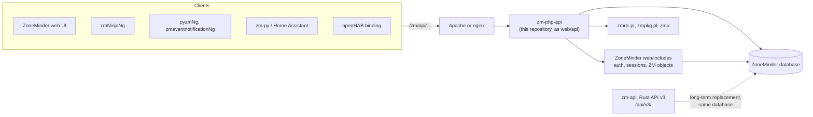
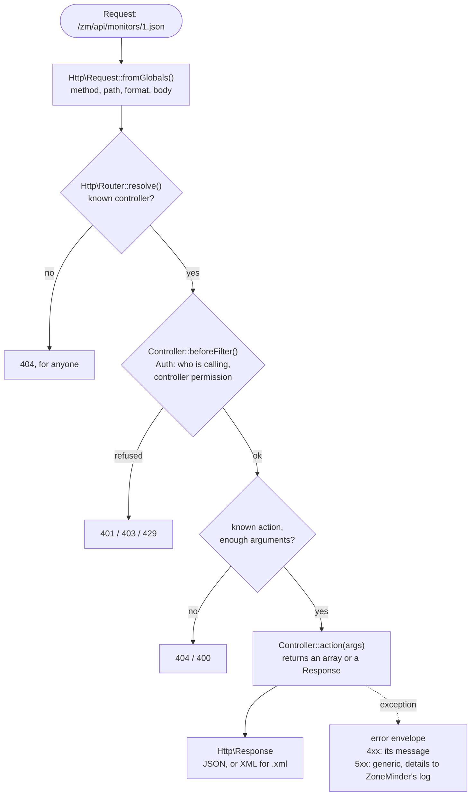
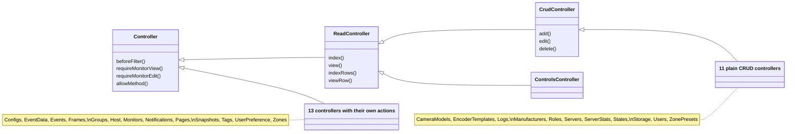
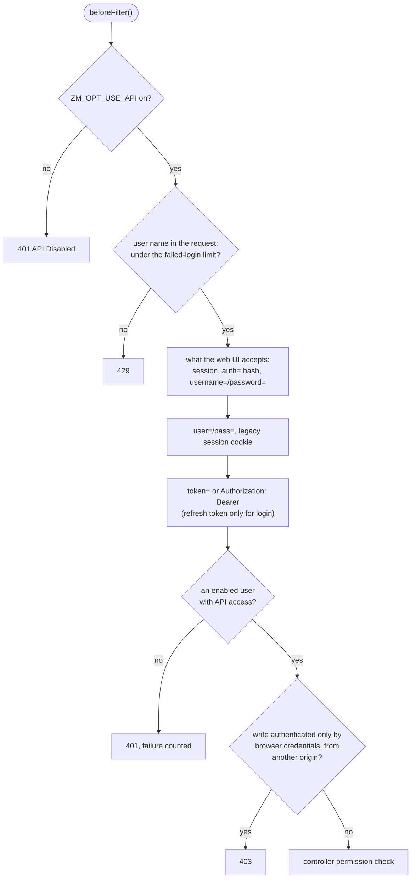
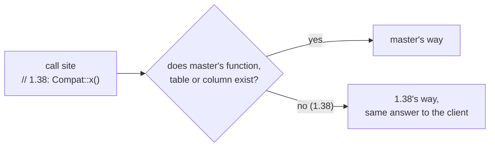

# Architecture

The REST API under `/zm/api/`, written in plain PHP on top of ZoneMinder's own
code (`web/includes`). It replaces the CakePHP 2 application that served the API
until now. CakePHP 2 has been end of life since 2021 and does not support the PHP
versions ZoneMinder runs on.

The URLs, answers and errors are the ones clients (zmNinja, zmeventnotification,
pyzm, Home Assistant, the web UI) already use. Known bugs of the old API were
fixed on the way; they are listed under [What changed](#what-changed).

This was verified with an API contract suite that records every action's answers
(status, content type, body structure, error messages) for each role and
compares two implementations request by request. It isn't public yet and is
meant to move into ZoneMinder's tests.

## Where it fits



zm-php-api replaces only the CakePHP application under `web/api`. Everything
it relies on (authentication, permissions, monitors and events as objects, the
database connection) is ZoneMinder's own code, so the API and the console
decide the same way.

## How a request is handled



| Step | Class | What it decides |
|---|---|---|
| Parse | `Http\Request::fromGlobals()` | Method (with `_method` overrides), path decoded once, `.json`/`.xml`, body |
| Route | `Http\Router::resolve()` | Which controller and action, named and passed arguments |
| Authenticate | `Controller::beforeFilter()` | Who is calling, and the controller's permission |
| Act | `Controller::<action>(args)` | The body, as an array, or a `Response` |
| Answer | `Http\Response` | JSON (or XML), or the error envelope |

`App::handle()` runs this and turns any exception into an error answer. The
order matters to clients: an unknown controller is a 404 for anyone, while an
unknown action is only reported after authentication.

## Layout

Paths are under `api/src/` unless noted.

| Path | What it is |
|---|---|
| `api/dispatch.php` | Front controller: the web server sends every `/zm/api/` request here |
| `bootstrap.php` | Class loading: `ZM\Api\X\Y` is `src/X/Y.php` |
| `App.php` | Route, authenticate, run the action, answer |
| `Auth.php` | Authentication (sessions, tokens, user/pass) and CORS |
| `TokenCache.php` | A token's user and permissions, kept 5 s (APCu) |
| `Compat.php` | Every difference between ZoneMinder 1.38 and master the API depends on (see "ZoneMinder 1.38") |
| `Filter.php` | `Name:value` filters for index actions |
| `Paginator.php` | `page`/`limit`/`sort`/`direction` and the `pagination` block |
| `Http/` | `Request`, `Router`, `Response`, `Xml`, and the exceptions that become HTTP errors |
| `Db/` | `Db` (queries on ZoneMinder's connection), `Conditions` (WHERE from arrays), `Model` (base of the models), `Schema` (table columns, cached) |
| `Model/` | One class per table: its alias, associations and validation |
| `Controller/` | One class per URL name: `MonitorsController` answers `/api/monitors/...` |

## URLs

```
GET    <resource>             index      {"monitors": [...]}
GET    <resource>/<id>        view       {"monitor": {...}}
POST   <resource>             add
PUT    <resource>/<id>        edit       (POST <resource>/<id> too)
DELETE <resource>/<id>        delete
any    <controller>/<action>[/<arg>...]
```

The first five apply to the names in `Router::RESOURCES`. Every action is also
reached as `<controller>/<action>/<args>`, and that is the only way to reach the
others (`monitors/alarm/id:1/command:on`, `events/consoleEvents/1 hour`).
Arguments written `Name:value` are named (`$this->named('id')`); the others are
passed to the action method as parameters. `.json` or `.xml` picks the format.

## Writing an action

An action is a public method of a controller. It returns the body as an array
of top-level keys, or a `Response`, and throws an `Http\HttpException` to fail:

```php
/** monitors/status/<id>: {"status": ...} */
public function status($id = null) {
  $monitor = $this->requireMonitorView($id);     // 404 Invalid monitor / 401 Insufficient Privileges
  return array('status' => $monitor->Status());
}
```

- **Errors:** `NotFoundException('Invalid monitor')`, `UnauthorizedException(...)`,
  `BadRequestException(...)`, `ForbiddenException(...)`,
  `MethodNotAllowedException(...)`. Their message is the body's `name` and
  `message`. Anything else that escapes an action is a 500 that says only
  "An Internal Error Has Occurred."; the real error goes to ZoneMinder's log.
- **Permissions:** `beforeFilter()` authenticates. A controller whose actions all
  need a permission overrides it and checks after `parent::beforeFilter()`.
  `requirePermission($area, $level)` grants an area by the user's own field or
  their role's (User_Roles), as `ZM\User::canView()/canEdit()` and the web UI
  do; an area off `Controller::PERMISSION_AREAS` fails closed. Use
  the helpers in `Controller`: `requireMonitorView/Edit()`, `requireEventsView()`,
  `viewableMonitorCondition()`, `filterContainedEvents()`. Per-monitor access
  (Monitors_Permissions, group permissions) is decided by ZoneMinder's
  `ZM\Monitor::canView()`/`canEdit()` and `ZM\Event::canView()`, the same code
  the console uses. Use those, never a coarse permission alone.
- **Writes:** never let the body choose the row an edit applies to. Drop the
  primary key from the request data (`withoutPrimaryKey()`, `withoutId()`) and
  pass the id from the URL to `save($data, $id)`.
- **Methods:** `$this->allowMethod('POST', 'DELETE')` for actions that change
  things, so a GET (a link, an image tag) can't trigger them.
- **Shell commands:** pass every argument through `escapeshellarg()`.
- **Style:** ZoneMinder's PHP style (2 spaces, `array()`). Use `&&`/`||`, not
  `and`/`or`, in an assignment: `$a = $b or $c` assigns `$b`.

Most resources are plain CRUD on one table: extend `ReadController` (index,
view) or `CrudController` (plus add, edit, delete) and set the constants, as
`ServersController` does. Override an action or the `indexRows()`/`viewRow()`
hooks for the rest.

How the controllers build on each other:




## Models and queries

A model names its table and alias and declares its associations and validation
(see `Db/Model.php` for the options):

```php
class Zone extends Model {
  const TABLE = 'Zones';
  const ALIAS = 'Zone';
  protected $belongsTo = array('Monitor' => array('model' => Monitor::class, 'foreignKey' => 'MonitorId'));
  protected $validate = array('Name' => array(array('rule' => 'notBlank')));
}
```

`find('all'|'first'|'count'|'list', $options)` returns rows keyed by alias, the
layout clients receive: `array('Zone' => array(...), 'Monitor' => array(...))`.
`recursive` sets how much is nested: -1 the row only, 0 plus `belongsTo`/`hasOne`
(joined), 1 plus `hasMany`/HABTM lists. Conditions are arrays
(`array('Zone.MonitorId' => 3, 'Name LIKE' => '%door%')`, see `Db/Conditions.php`);
values are always bound. Never build a condition string from request input.

`save($data, $id)` takes `Model[Field]` or bare fields, ignores anything that
isn't a column, validates, and inserts or updates. `delete($id)` also removes
dependent `hasMany` rows and HABTM links.

Values come back with the types clients have always seen: integers and floats
as numbers, `TINYINT(1)` as booleans, DECIMAL and dates as strings (`Db.php`).
The API's statements are prepared client-side (one round trip each, values still
bound); ZoneMinder's own queries on the shared connection stay server-side.
Table columns come from `Db\Schema`, kept in APCu for a minute under a key that
names ZoneMinder's version and database version. JSON is encoded with
`json_encode()`'s default flags, so `/` is `\/`.

## Authentication and security



`Auth::authenticate()` accepts, in order: what the web UI accepts
(`zm_authenticate_request()`: session, `auth=` hashes, `username=`/`password=`),
`user=`/`pass=`, the session cookie (with `ZM_OPT_USE_LEGACY_API_AUTH`), and a
token: `token=` or an `Authorization: Bearer` header. Prefer the header: a token in
the URL ends up in web server and proxy logs. Apache passes the header to PHP only
with `CGIPassAuth On` (or the `SetEnvIf Authorization` idiom) in some setups.

- **Token cache:** after a full check of an access token (any action but a
  login, no other credential in the request), its Users row and the user's
  monitor and group permission rows are kept in APCu for `TokenCache::TTL` (5)
  seconds, never past the token's expiry, under an HMAC of the token with
  `ZM_AUTH_HASH_SECRET` (never the token). Calls with that token in the window
  read none of them. So a change made in the database or the web UI (token
  revocation via `TokenMinExpiry`, `APIEnabled`, `Enabled`, permissions) reaches
  a token in use within 5 s; a user saved or deleted through the API empties the
  cache at once (on that server). Without APCu every call is checked in full.
- **Failed logins** are counted per client address (APCu): after
  `Auth::LOGIN_FAILURES` wrong passwords within `Auth::LOGIN_WINDOW` seconds,
  password logins from that address answer 429 until the window has passed. Tokens
  still work. Behind a reverse proxy, set `ZM_AUTH_TRUSTED_PROXIES` so the address is
  the client's. Without APCu there is no throttling.
- **GETs that change state** (alarms on/off, daemon start/stop, `states/change`)
  are refused (403) when the only credential is one a browser sends by itself
  (the session cookie, HTTP basic auth), so a link or image on another site can't
  trigger them. Use `Auth::requireExplicitForGet()` in any new action of that kind.
- **CORS:** only Origins naming a server of this install get credentials
  (`Auth::cors()`).
- **Stateful login** (`stateful=1` with user/pass) issues a new session id and
  drops what the old one held, so a session id planted in the client beforehand
  doesn't become the logged-in session. The session never holds the password,
  even with `ZM_AUTH_RELAY=plain`.
- **zmu** gets `Auth::zmuCredentials()`: an access token minted for the call that
  lives a minute, never the password or the client's own token, because a command
  line is visible to every local user. Without a usable `ZM_AUTH_HASH_SECRET` zmu
  refuses tokens, so it gets the auth hash (hashed relay), the user name (relay
  none), or with the plain relay the request's own password, else the web UI
  session's; a call with neither fails. Set the secret.

## Upgrading

ZoneMinder's Apache and nginx configurations, and those written for the
CakePHP API, send `/zm/api` to `web/api/app/webroot/index.php` or
`web/api/index.php`. Both are small files here that forward to `dispatch.php`,
so no web server change is needed. To route to `dispatch.php` directly, see
`contrib/webserver/` (Apache: one `RewriteRule ^ dispatch.php [L,QSA]` in
`<Directory .../api>`; nginx: `rewrite ^/zm/api(.+)$ /zm/api/dispatch.php?p=$1 last;`).

## ZoneMinder 1.38

The API is written against master and runs on 1.38 too. Whatever 1.38 lacks
(a function of `web/includes`, a table, a column) is asked of `Compat.php`
rather than used directly, and each `Compat` method takes master's way when
the thing is there. It probes for the thing itself, never `ZM_VERSION`, so a
backport to 1.38 is used as soon as it is there. On 1.38 the API answers as on
master; features master alone has stay absent (404, as 1.38's CakePHP API).



When you use something new from `web/includes` or the schema, check that 1.38
has it (`git diff origin/release-1.38 origin/master -- web/includes db`). If it
doesn't, add a `Compat` method that names the master commit that brought it,
mark the call site `// 1.38:`, and run the unit tests against both trees:

```bash
ZM_SRC=/path/to/zoneminder-master tests/run.sh
ZM_SRC=/path/to/zoneminder-1.38 tests/run.sh
```

A controller for a table 1.38 lacks declares `const REQUIRES_TABLE = 'Table';`
and the router treats it as missing there. When 1.38 is no longer supported,
delete `Compat.php` and keep the master branch of each `Compat::` call.

## Compatibility

The answers are a published interface. Before changing one (a key, a type, a
status code, an error message), check what clients do with it, and run the
contract suite (see above), which pins all of them.

The suite's `--ref-api` mode sends each GET to a second implementation too
and compares the bodies, values included. Without it, test with curl, and `php -l`
every file you touch.

## What changed

Fixed relative to the CakePHP API (the contract suite has a record of each, with
the old and the fixed answer):

- **Security:** 16 hardening changes, see [SECURITY.md](../SECURITY.md).
- **Broken endpoints that work now:**
  - `roles`, `server_stats/<id>`, `zone_presets/view`, `logs/view`, `logs/add`, `user_preference/edit`.
  - `host/login` with legacy auth and `ZM_AUTH_RELAY=plain` names the user in `credentials` (it was `user=&pass=`, from a session key that is never set).
  - Tags add/edit/delete. These need Events=Edit; there is no Tags permission.
  - `groups/edit` with members.
  - `storage/<id>`, `configs/<Name>` and `configs/<Id>`, and the `cameramodels`/`models`/`zonepresets` resource names.
  - `ZM_USER_SELF_EDIT`.
  - `host/daemonControl` for admins.
- **Wrong answers that are right now:**
  - Unknown filter fields, bad intervals and duplicate records are a 400, not a 500.
  - `IS NOT:NULL` filters work.
  - Monitor filters on `Name`/`Id` work.
  - `events/index` honours `sort`/`direction` without `limit`.
  - `MaxScoreFrameId` is the frame number.
  - Intervals like `1-1 YEAR_MONTH` mean what MySQL means by them.
  - GET on add/edit actions is a 405, not template source or a 500.
  - Snapshots are listed once each, and `snapshots/associations` lists their events.
  - An event's `Group` lists its monitor's groups.
  - Editing a monitor's control settings restarts its control daemon (zmcontrol.pl).
- **Not carried over:**
  - Requests without an extension get JSON (the CakePHP API answered an HTML error page).
  - The exception class in error bodies is the CakePHP name for HTTP errors, and the PHP class for internal ones.
